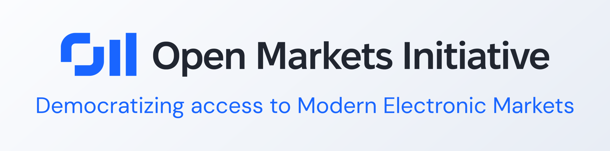

<a href="About/">
  <picture>
    <source media="(prefers-color-scheme: dark)" srcset="About/Banners/Dark.png">
    
  </picture>
</a>

# The Open Markets Initiative

  

[The Open Markets Initiative](About/) (Omi) is a market-neutral effort to enhance the stability of electronic financial markets through transparency, modern tooling, and open documentation of the wire protocols that connect them.

---

## Organizations

> [24X](Organizations/24X/) · [A2X](Organizations/A2X/) · [Adx](Organizations/Adx/) · [Aix](Organizations/Aix/) · [Aquis](Organizations/Aquis/) · [AsiaNext](Organizations/AsiaNext/) · [Asx](Organizations/Asx/) · [Athex](Organizations/Athex/) · [B3](Organizations/B3/) · [Bet](Organizations/Bet/) · [Binance](Organizations/Binance/) · [Bist](Organizations/Bist/) · [Bitstamp](Organizations/Bitstamp/) · [Bitvavo](Organizations/Bitvavo/) · [Biva](Organizations/Biva/) · [Bjse](Organizations/Bjse/) · [BlueOceanAts](Organizations/BlueOceanAts/) · [Bme](Organizations/Bme/) · [Bmv](Organizations/Bmv/) · [Box](Organizations/Box/) · [Brm](Organizations/Brm/) · [BruceAts](Organizations/BruceAts/) · [Bse](Organizations/Bse/) · [Bullish](Organizations/Bullish/) · [Bursa](Organizations/Bursa/) · [Bvb](Organizations/Bvb/) · [Cboe](Organizations/Cboe/) · [Cffex](Organizations/Cffex/) · [CixAts](Organizations/CixAts/) · [Cme](Organizations/Cme/) · [Cnsx](Organizations/Cnsx/) · [Coinbase](Organizations/Coinbase/) · [Cse](Organizations/Cse/) · [Currenex](Organizations/Currenex/) · [Cyse](Organizations/Cyse/) · [Databento](Organizations/Databento/) · [Dce](Organizations/Dce/) · [Eex](Organizations/Eex/) · [ElectronX](Organizations/ElectronX/) · [Eurex](Organizations/Eurex/) · [Euronext](Organizations/Euronext/) · [Fenics](Organizations/Fenics/) · [Finra](Organizations/Finra/) · [Fix](Organizations/Fix/) · [Fxcm](Organizations/Fxcm/) · [Gme](Organizations/Gme/) · [Gpw](Organizations/Gpw/) · [Henex](Organizations/Henex/) · [Hkex](Organizations/Hkex/) · [Hnx](Organizations/Hnx/) · [Hose](Organizations/Hose/) · [Ice](Organizations/Ice/) · [Iex](Organizations/Iex/) · [Imperative](Organizations/Imperative/) · [Indx](Organizations/Indx/) · [Jfx](Organizations/Jfx/) · [Jnx](Organizations/Jnx/) · [Jpx](Organizations/Jpx/) · [Jse](Organizations/Jse/) · [Kalshi](Organizations/Kalshi/) · [Kase](Organizations/Kase/) · [Koscom](Organizations/Koscom/) · [Kraken](Organizations/Kraken/) · [KronosX](Organizations/KronosX/) · [Ljse](Organizations/Ljse/) · [Lmax](Organizations/Lmax/) · [Lme](Organizations/Lme/) · [Lseg](Organizations/Lseg/) · [Ltse](Organizations/Ltse/) · [MatbaRofex](Organizations/MatbaRofex/) · [Memx](Organizations/Memx/) · [Mepx](Organizations/Mepx/) · [Miax](Organizations/Miax/) · [Moex](Organizations/Moex/) · [Msx](Organizations/Msx/) · [Nairobi](Organizations/Nairobi/) · [Nasdaq](Organizations/Nasdaq/) · [Neeq](Organizations/Neeq/) · [Nextrade](Organizations/Nextrade/) · [Ngm](Organizations/Ngm/) · [Nse](Organizations/Nse/) · [NsxAustralia](Organizations/NsxAustralia/) · [NsxNamibia](Organizations/NsxNamibia/) · [Nyse](Organizations/Nyse/) · [Nzx](Organizations/Nzx/) · [Odx](Organizations/Odx/) · [Okx](Organizations/Okx/) · [OneChronos](Organizations/OneChronos/) · [OneTrading](Organizations/OneTrading/) · [Osl](Organizations/Osl/) · [OtcMarkets](Organizations/OtcMarkets/) · [Pse](Organizations/Pse/) · [Qse](Organizations/Qse/) · [Revolut](Organizations/Revolut/) · [RuleMatch](Organizations/RuleMatch/) · [Set](Organizations/Set/) · [Sfox](Organizations/Sfox/) · [Sgx](Organizations/Sgx/) · [Shfe](Organizations/Shfe/) · [Siac](Organizations/Siac/) · [Six](Organizations/Six/) · [SmallX](Organizations/SmallX/) · [Sse](Organizations/Sse/) · [Szse](Organizations/Szse/) · [Taifex](Organizations/Taifex/) · [Tase](Organizations/Tase/) · [Tfx](Organizations/Tfx/) · [Tmx](Organizations/Tmx/) · [Tpex](Organizations/Tpex/) · [TpIcap](Organizations/TpIcap/) · [Tradelogiq](Organizations/Tradelogiq/) · [Twse](Organizations/Twse/) · [Txse](Organizations/Txse/) · [Wbag](Organizations/Wbag/) · [Zce](Organizations/Zce/) · [ZeroHash](Organizations/ZeroHash/)

---

## Exchanges and Ats

> [24XEquities](Organizations/24X/Protocols/24XEquities/) · [A2XEquities](Organizations/A2X/Protocols/A2XEquities/) · [AmexEquities](Organizations/Nyse/Protocols/AmexEquities/) · [AmexOptions](Organizations/Nyse/Protocols/AmexOptions/) · [AquisEquities](Organizations/Aquis/Protocols/AquisEquities/) · [AquisStockExchange](Organizations/Aquis/Protocols/AquisStockExchange/) · [ArcaEquities](Organizations/Nyse/Protocols/ArcaEquities/) · [ArcaOptions](Organizations/Nyse/Protocols/ArcaOptions/) · [AsxDerivatives](Organizations/Asx/Protocols/AsxDerivatives/) · [AsxSecurities](Organizations/Asx/Protocols/AsxSecurities/) · [AthexDerivatives](Organizations/Athex/Protocols/AthexDerivatives/) · [AthexSecurities](Organizations/Athex/Protocols/AthexSecurities/) · [B3Derivatives](Organizations/B3/Protocols/B3Derivatives/) · [BidsEurope](Organizations/Cboe/Protocols/BidsEurope/) · [BidsJapan](Organizations/Cboe/Protocols/BidsJapan/) · [BjseSecurities](Organizations/Bjse/Protocols/BjseSecurities/) · [BlueEquities](Organizations/BlueOceanAts/Protocols/BlueEquities/) · [BmeEquities](Organizations/Bme/Protocols/BmeEquities/) · [BmeFixedIncome](Organizations/Bme/Protocols/BmeFixedIncome/) · [BmvMarketData](Organizations/Bmv/Protocols/BmvMarketData/) · [BondSpot](Organizations/Gpw/Protocols/BondSpot/) · [BorsaIstanbul](Organizations/Bist/Protocols/BorsaIstanbul/) · [BoxOptions](Organizations/Box/Protocols/BoxOptions/) · [BrokerTec](Organizations/Cme/Protocols/BrokerTec/) · [BseIndia](Organizations/Bse/Protocols/BseIndia/) · [BxeEquities](Organizations/Cboe/Protocols/BxeEquities/) · [ByxEquities](Organizations/Cboe/Protocols/ByxEquities/) · [BzxEquities](Organizations/Cboe/Protocols/BzxEquities/) · [BzxOptions](Organizations/Cboe/Protocols/BzxOptions/) · [C1Options](Organizations/Cboe/Protocols/C1Options/) · [C2Options](Organizations/Cboe/Protocols/C2Options/) · [CboeEurope](Organizations/Cboe/Protocols/CboeEurope/) · [CboeFx](Organizations/Cboe/Protocols/CboeFx/) · [CedxDerivatives](Organizations/Cboe/Protocols/CedxDerivatives/) · [CfeFutures](Organizations/Cboe/Protocols/CfeFutures/) · [CoinbaseDerivatives](Organizations/Coinbase/Protocols/CoinbaseDerivatives/) · [CurrenexForex](Organizations/Currenex/Protocols/CurrenexForex/) · [CxaEquities](Organizations/Cboe/Protocols/CxaEquities/) · [CxeEquities](Organizations/Cboe/Protocols/CxeEquities/) · [CxjEquities](Organizations/Cboe/Protocols/CxjEquities/) · [CxjSor](Organizations/Cboe/Protocols/CxjSor/) · [Deribit](Organizations/Coinbase/Protocols/Deribit/) · [DxeEquities](Organizations/Cboe/Protocols/DxeEquities/) · [Ebs](Organizations/Cme/Protocols/Ebs/) · [EdgaEquities](Organizations/Cboe/Protocols/EdgaEquities/) · [EdgxEquities](Organizations/Cboe/Protocols/EdgxEquities/) · [EdgxOptions](Organizations/Cboe/Protocols/EdgxOptions/) · [ElectricDerivatives](Organizations/ElectronX/Protocols/ElectricDerivatives/) · [EmeraldOptions](Organizations/Miax/Protocols/EmeraldOptions/) · [FinraOrf](Organizations/Finra/Protocols/FinraOrf/) · [FinraOtc](Organizations/Finra/Protocols/FinraOtc/) · [FixedIncome](Organizations/Cboe/Protocols/FixedIncome/) · [GemxOptions](Organizations/Nasdaq/Protocols/GemxOptions/) · [HkexDerivatives](Organizations/Hkex/Protocols/HkexDerivatives/) · [HkexSecurities](Organizations/Hkex/Protocols/HkexSecurities/) · [IceFutures](Organizations/Ice/Protocols/IceFutures/) · [Idem](Organizations/Lseg/Protocols/Idem/) · [IexEquities](Organizations/Iex/Protocols/IexEquities/) · [IexOptions](Organizations/Iex/Protocols/IexOptions/) · [IntelligentCross](Organizations/Imperative/Protocols/IntelligentCross/) · [IseOptions](Organizations/Nasdaq/Protocols/IseOptions/) · [JnxBonds](Organizations/Jnx/Protocols/JnxBonds/) · [JnxEquities](Organizations/Jnx/Protocols/JnxEquities/) · [LinkAts](Organizations/OtcMarkets/Protocols/LinkAts/) · [LinkEcn](Organizations/OtcMarkets/Protocols/LinkEcn/) · [LinkNqb](Organizations/OtcMarkets/Protocols/LinkNqb/) · [Lse](Organizations/Lseg/Protocols/Lse/) · [LtseEquities](Organizations/Ltse/Protocols/LtseEquities/) · [LynxAts](Organizations/Tradelogiq/Protocols/LynxAts/) · [MatchNow](Organizations/Cboe/Protocols/MatchNow/) · [Meff](Organizations/Bme/Protocols/Meff/) · [MemxEquities](Organizations/Memx/Protocols/MemxEquities/) · [MemxOptions](Organizations/Memx/Protocols/MemxOptions/) · [MiaxOptions](Organizations/Miax/Protocols/MiaxOptions/) · [MoonAts](Organizations/OtcMarkets/Protocols/MoonAts/) · [MrxOptions](Organizations/Nasdaq/Protocols/MrxOptions/) · [NairobiEquities](Organizations/Nairobi/Protocols/NairobiEquities/) · [NasdaqCanada](Organizations/Nasdaq/Protocols/NasdaqCanada/) · [NationalEquities](Organizations/Nyse/Protocols/NationalEquities/) · [NeeqSecurities](Organizations/Neeq/Protocols/NeeqSecurities/) · [NeoEquities](Organizations/Cboe/Protocols/NeoEquities/) · [NfxFutures](Organizations/Nasdaq/Protocols/NfxFutures/) · [NlxDerivatives](Organizations/Nasdaq/Protocols/NlxDerivatives/) · [NomOptions](Organizations/Nasdaq/Protocols/NomOptions/) · [NordicDerivatives](Organizations/Nasdaq/Protocols/NordicDerivatives/) · [NordicEquities](Organizations/Nasdaq/Protocols/NordicEquities/) · [NsmEquities](Organizations/Nasdaq/Protocols/NsmEquities/) · [NtxEquities](Organizations/Nasdaq/Protocols/NtxEquities/) · [NtxOptions](Organizations/Nasdaq/Protocols/NtxOptions/) · [NyseBonds](Organizations/Nyse/Protocols/NyseBonds/) · [NyseEquities](Organizations/Nyse/Protocols/NyseEquities/) · [NyseOptions](Organizations/Nyse/Protocols/NyseOptions/) · [OdxEquities](Organizations/Odx/Protocols/OdxEquities/) · [OdxSecurityToken](Organizations/Odx/Protocols/OdxSecurityToken/) · [OkxDigital](Organizations/Okx/Protocols/OkxDigital/) · [OmegaAts](Organizations/Tradelogiq/Protocols/OmegaAts/) · [OnyxFutures](Organizations/Miax/Protocols/OnyxFutures/) · [OseDerivatives](Organizations/Jpx/Protocols/OseDerivatives/) · [Overnight](Organizations/OtcMarkets/Protocols/Overnight/) · [PearlEquities](Organizations/Miax/Protocols/PearlEquities/) · [PearlOptions](Organizations/Miax/Protocols/PearlOptions/) · [PhlxOptions](Organizations/Nasdaq/Protocols/PhlxOptions/) · [PseEquities](Organizations/Pse/Protocols/PseEquities/) · [PsxEquities](Organizations/Nasdaq/Protocols/PsxEquities/) · [SapphireOptions](Organizations/Miax/Protocols/SapphireOptions/) · [SmallFutures](Organizations/SmallX/Protocols/SmallFutures/) · [Spectra](Organizations/Moex/Protocols/Spectra/) · [Sse](Organizations/Hkex/Protocols/Sse/) · [SseSecurities](Organizations/Sse/Protocols/SseSecurities/) · [Szse](Organizations/Hkex/Protocols/Szse/) · [SzseSecurities](Organizations/Szse/Protocols/SzseSecurities/) · [TaifexDerivatives](Organizations/Taifex/Protocols/TaifexDerivatives/) · [TexasEquities](Organizations/Nyse/Protocols/TexasEquities/) · [Trace](Organizations/Finra/Protocols/Trace/) · [TradeEcho](Organizations/Lseg/Protocols/TradeEcho/) · [TseEquities](Organizations/Jpx/Protocols/TseEquities/) · [Turquoise](Organizations/Lseg/Protocols/Turquoise/) · [TxseEquities](Organizations/Txse/Protocols/TxseEquities/) · [Wse](Organizations/Gpw/Protocols/Wse/)

---

## Consolidators and Sips

> [Cqs](Organizations/Siac/Protocols/Cqs/) · [Cts](Organizations/Siac/Protocols/Cts/) · [FundNetwork](Organizations/Nasdaq/Protocols/FundNetwork/) · [Index](Organizations/Nasdaq/Protocols/Index/) · [MdcsRealtime](Organizations/Koscom/Protocols/MdcsRealtime/) · [NordicMarkets](Organizations/Nasdaq/Protocols/NordicMarkets/) · [Opra](Organizations/Siac/Protocols/Opra/) · [TitaniumConsolidated](Organizations/Cboe/Protocols/TitaniumConsolidated/)

---

## Redistributors

> [Databento](Organizations/Databento/Protocols/MarketData/)

---

## Platforms

> [Athex Oasis](Organizations/Athex/Protocols/Oasis/) · [CixAts CixAspen](Organizations/CixAts/Protocols/CixAspen/) · [Cme Globex](Organizations/Cme/Protocols/Globex/) · [Eurex T7](Organizations/Eurex/Protocols/T7/) · [Euronext Optiq](Organizations/Euronext/Protocols/Optiq/) · [Jse Itac](Organizations/Jse/Protocols/Itac/) · [Lseg Millennium](Organizations/Lseg/Protocols/Millennium/) · [Moex Asts](Organizations/Moex/Protocols/Asts/) · [Ngm Elasticia](Organizations/Ngm/Protocols/Elasticia/) · [NsxAustralia Nets](Organizations/NsxAustralia/Protocols/Nets/) · [Sgx TitanDt](Organizations/Sgx/Protocols/TitanDt/) · [Sgx TitanOtc](Organizations/Sgx/Protocols/TitanOtc/)

---

## Related Omi Repositories

The Directory is the human-readable catalog. The machine-readable specifications live elsewhere and drive the source-generated artifacts:

**Source Generated Languages**

*C++*

- [omi-cpp-protocols][omi-cpp-protocols] — Source generated C++ protocol parsers and utilities
- [omi-cpp-formats][omi-cpp-formats] — Source generated C++ translations for formats like JSON and Parquet
- [omi-cpp-databases][omi-cpp-databases] — Source generated C++ programs that load packet captures into databases

*C#*

- [omi-csharp-protocols][omi-csharp-protocols] — Source generated C# protocol parsers, fixed-layout structs and immutable classes

*Rust*

- [omi-rust-protocols][omi-rust-protocols] — Zero-copy Rust message views, one crate per protocol version

*Java*

- [omi-java-protocols][omi-java-protocols] — Garbage-collector friendly Java binary protocol classes

**Generated Definitions**

- [omi-kaitai-struct-definitions][omi-kaitai-struct-definitions] — Kaitai Struct definitions for common exchange binary protocols
- [omi-dfdl-definitions][omi-dfdl-definitions] — Data Format Description Language schemas for common exchange protocols
- [omi-p4-definitions][omi-p4-definitions] — P4 definitions for common exchange protocols for software and hardware data planes
- [omi-fix-dictionaries][omi-fix-dictionaries] — FIX protocol dictionaries (QuickFIX-format XML, one per FIX version)
- [omi-spicy-definitions][omi-spicy-definitions] — Spicy grammars for common exchange binary protocols, for the Spicy toolchain and Zeek
- [omi-lean4-definitions][omi-lean4-definitions] — Lean 4 definitions of common exchange binary protocols, with proofs
- [omi-rocq-definitions][omi-rocq-definitions] — Rocq Prover definitions of common exchange binary protocols, with proofs
- [omi-tlaplus-definitions][omi-tlaplus-definitions] — TLA+ definitions of common exchange binary protocols, model checked with TLC
- [omi-promela-definitions][omi-promela-definitions] — Promela definitions of common exchange binary protocols, model checked with Spin
- [omi-xml-specifications][omi-xml-specifications] — XML specifications for common exchange protocols

**Telemetry**

- [omi-wireshark-lua][omi-wireshark-lua] — Source generated cross platform Wireshark dissectors
- [omi-wireshark-c][omi-wireshark-c] — Source generated Wireshark dissectors in C, built in to Wireshark

**Reference Material**

- [omi-low-latency-reference][omi-low-latency-reference] — Knowledge base for low latency programming
- [omi-markets-reference][omi-markets-reference] — Knowledge base for market data collection and analysis

**Production Sample Data**

- [omi-data-packets][omi-data-packets] — Example protocol data captures
- [omi-data-pcaps][omi-data-pcaps] — Exchange pcaps for automated testing

**Esoteric Languages**

- [omi-esoteric-languages][omi-esoteric-languages] — Source generated exchanges in esoteric languages like Brainfuck and Emojicode

A complete list lives in [Repositories](Repositories).

---

Documentation is collected from publicly available sources — corrections and additions are welcome as issues or pull requests. Read more about the mission in [About](About).

*Specifications belong to their respective owners; this directory aggregates pointers and historical context only.*

[omi-cpp-protocols]: https://github.com/Open-Markets-Initiative/omi-cpp-protocols "Source generated C++ protocol parsers and utilities"
[omi-cpp-formats]: https://github.com/Open-Markets-Initiative/omi-cpp-formats "Source generated C++ translations for formats like JSON and Parquet"
[omi-cpp-databases]: https://github.com/Open-Markets-Initiative/omi-cpp-databases "Source generated C++ programs that load packet captures into databases"
[omi-csharp-protocols]: https://github.com/Open-Markets-Initiative/omi-csharp-protocols "Source generated C# protocol parsers, fixed-layout structs and immutable classes"
[omi-rust-protocols]: https://github.com/Open-Markets-Initiative/omi-rust-protocols "Zero-copy Rust message views, one crate per protocol version"
[omi-java-protocols]: https://github.com/Open-Markets-Initiative/omi-java-protocols "Garbage-collector friendly Java binary protocol classes"
[omi-kaitai-struct-definitions]: https://github.com/Open-Markets-Initiative/omi-kaitai-struct-definitions "Kaitai Struct definitions for common exchange binary protocols"
[omi-dfdl-definitions]: https://github.com/Open-Markets-Initiative/omi-dfdl-definitions "Data Format Description Language schemas for common exchange protocols"
[omi-p4-definitions]: https://github.com/Open-Markets-Initiative/omi-p4-definitions "P4 definitions for common exchange protocols for software and hardware data planes"
[omi-fix-dictionaries]: https://github.com/Open-Markets-Initiative/omi-fix-dictionaries "FIX protocol dictionaries (QuickFIX-format XML, one per FIX version)"
[omi-spicy-definitions]: https://github.com/Open-Markets-Initiative/omi-spicy-definitions "Spicy grammars for common exchange binary protocols, for the Spicy toolchain and Zeek"
[omi-lean4-definitions]: https://github.com/Open-Markets-Initiative/omi-lean4-definitions "Lean 4 definitions of common exchange binary protocols, with proofs"
[omi-rocq-definitions]: https://github.com/Open-Markets-Initiative/omi-rocq-definitions "Rocq Prover definitions of common exchange binary protocols, with proofs"
[omi-tlaplus-definitions]: https://github.com/Open-Markets-Initiative/omi-tlaplus-definitions "TLA+ definitions of common exchange binary protocols, model checked with TLC"
[omi-promela-definitions]: https://github.com/Open-Markets-Initiative/omi-promela-definitions "Promela definitions of common exchange binary protocols, model checked with Spin"
[omi-xml-specifications]: https://github.com/Open-Markets-Initiative/omi-xml-specifications "XML specifications for common exchange protocols"
[omi-wireshark-lua]: https://github.com/Open-Markets-Initiative/omi-wireshark-lua "Source generated cross platform Wireshark dissectors"
[omi-wireshark-c]: https://github.com/Open-Markets-Initiative/omi-wireshark-c "Source generated Wireshark dissectors in C, built in to Wireshark"
[omi-low-latency-reference]: https://github.com/Open-Markets-Initiative/omi-low-latency-reference "Knowledge base for low latency programming"
[omi-markets-reference]: https://github.com/Open-Markets-Initiative/omi-markets-reference "Knowledge base for market data collection and analysis"
[omi-data-packets]: https://github.com/Open-Markets-Initiative/omi-data-packets "Example protocol data captures"
[omi-data-pcaps]: https://github.com/Open-Markets-Initiative/omi-data-pcaps "Exchange pcaps for automated testing"
[omi-esoteric-languages]: https://github.com/Open-Markets-Initiative/omi-esoteric-languages "Source generated exchanges in esoteric languages like Brainfuck and Emojicode"
